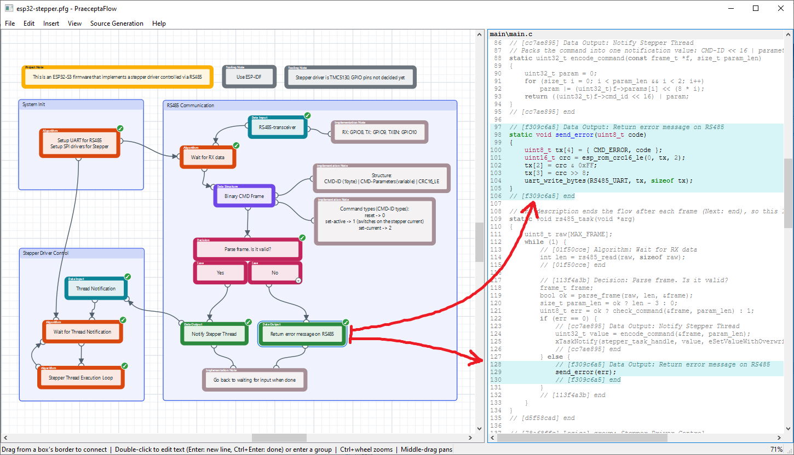

# PraeceptaFlow

Add structure to your vibe-coded projects. Describe your program as a flow graph, and [Claude Code](https://claude.com/claude-code) translates it into source code. Each flow graph item is linked to the code generated for it, so you can understand what the agent built in an instant. Be as detailed or as vague as you like: there is no syntax, only structure!



Built with PySide6 (Qt's Graphics View framework). This is a proof-of-concept for now: Windows only, hardly any tests, and the file format may change at any time.

## Requirements

- Windows
- Python 3.14 or later
- `claude` command on `PATH` and logged in

## Setup

```
setup.bat
```

## Scripts

| Task | Command |
|---|---|
| Run the app | `run.bat [file.pfg]` |
| Run the app with a console window | `run_console.bat [file.pfg]` |
| Build a PyInstaller bundle | `build.bat [--onefile]` |
| Remove `build\` and `dist\` | `clean.bat` |

## Usage

A graph is made of typed boxes connected by edges. Right-click the canvas (or use the Insert menu) to add a box, and drag from a box's border to another box to connect them.

| Box | Purpose |
|---|---|
| Data Input, Data Output, Data Structure, Algorithm | The steps of the program. Edges between them are the program flow. |
| Implementation Note, Tooling Note | Remarks about the steps they are connected to. Unconnected, they apply to the whole project. |
| Project Note | A remark about the whole project. It cannot be connected. |
| Decision | A step that branches (an if/else or switch): a header with what is decided and a row of cases beneath it. Edges leave from the cases. `+` adds a case, `-` removes one, dragging a case left or right reorders them. |
| Group | A box that holds a canvas of its own. Double-click it to enter (double-click its title to rename), go back with the path at the top left or Alt+Up. In the program flow a group stands for the steps inside it. |
| Logical Group | A coloured background for the boxes lying on it. Drag its title strip to move it with those boxes, its border to resize it. The code of its steps is kept together in the generated source. |

The graph is saved as `name.pfg` (JSON). More files appear beside it:

- `name.pd`: the project description, plain text derived from the graph and rewritten on every save and open. This is what Claude Code reads.
- `name.notes`: how the last generation realized each note.
- `name.issues`: the report of the last parity check. The next generation is told to fix what it lists, then removes it.

The Source Generation menu runs Claude Code in the folder of the graph:

- **Generate Source Code** (Ctrl+G) writes source code for the description. Each step's code is marked with a tag comment, so selecting a box highlights its code in the pane on the right. A logical group has its own tag around its steps and the code that supports them, so selecting it highlights all of that.
- **Check Parity** (Ctrl+Shift+G) compares the source code with the description without changing anything, and marks each box as matching, mismatching or unimplemented. The marks are stored in `name.issues`; a box loses its mark when its step is changed afterwards.

The model and effort level for both commands are chosen in the same menu.

## License

Copyright (C) 2026 VaTTeRGeR

This program is free software: you can redistribute it and/or modify it under the terms of the GNU General Public License as published by the Free Software Foundation, either version 3 of the License, or (at your option) any later version. It is distributed without any warranty. See [LICENSE](LICENSE) for the full text.

PraeceptaFlow uses [PySide6](https://doc.qt.io/qtforpython-6/) (LGPLv3) and [Pygments](https://pygments.org/) (BSD 2-Clause).
